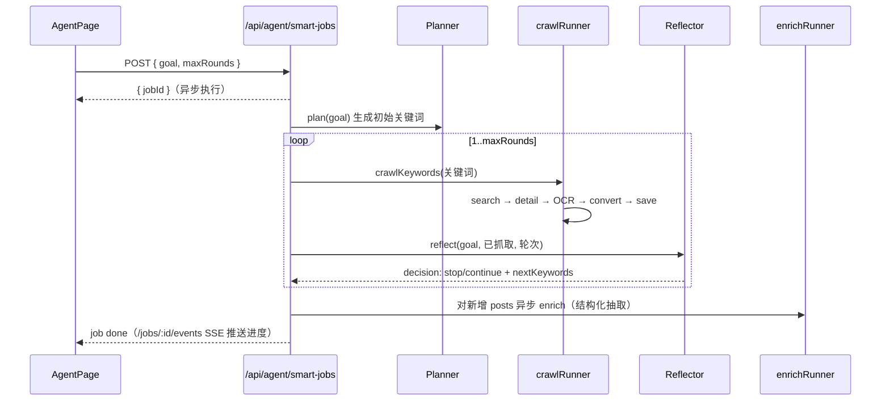

# 面经助手 — 小红书面经抓取与管理系统

> 自动从小红书搜索互联网岗位面试经验，通过 OCR 图文识别提取面经内容，结合 LLM Agent 提供智能抓取、结构化抽取、模拟面试与学习路径，存入 MySQL，并提供 Web 管理界面。

## 1. 登录与注册

> 当前版本**没有独立的用户账号体系**（无注册 / 密码 / 鉴权）。个人数据通过浏览器本地生成的匿名 ID 区分。

| 项 | 现状 | 说明 |
|------|------|------|
| 用户注册 / 登录 | ❌ 暂无 | 无账号、密码、JWT/Session |
| 匿名用户 ID | ✅ | `localStorage` 生成 UUID（`xhs_user_id`），经 `X-User-Id` 请求头传递 |
| 小红书扫码登录 | ✅ | 给抓取 MCP 用（`GET /api/mcp/login/qrcode`） |
| 登录态持久化 | ✅ | Cookies 存 `docker-data/cookies/cookies.json`，Docker 容器共享 |

- 笔记（`notes`）、模拟面试（`practices`）两张表以 `user_id` 区分个人数据，但它是**客户端自报的匿名 ID**——换浏览器或清缓存即丢失数据。
- 小红书登录在「数据抓取」页完成扫码，登录态供后端调用 MCP 抓取小红书内容使用，与用户账号体系无关。

## 2. 核心功能

| 功能 | 页面路由 | 说明 |
|------|----------|------|
| 首页概览 | `/` | 统计 + 最新/热门面经 |
| 面经列表 | `/posts` | 分类筛选、Web Worker 搜索、排序、优先级/已读状态 |
| 分类浏览 | `/categories` | 按 5 大岗位分类（前端/后端/测开/移动端/产品） |
| 数据看板 | `/dashboard` | Recharts 可视化：阅读进度、分类分布、热门标签 |
| 数据抓取 | `/crawl` | 手动关键词抓取 + 小红书扫码登录 |
| AI 助手（智能抓取） | `/agent` | 输入目标岗位 → Planner 规划 → 多轮抓取 → Reflector 反思 |
| 我的学习（笔记） | `/notes` | 收藏 + 笔记管理 |
| 学习路径 | `/learn` | 基于收藏面经聚合知识点 + 薄弱分析 |
| 模拟面试 | `/mock` | AI 出题 → 答题 → 多维度评分反馈 |
| 智能问答 | 侧边栏搜索框 | 基于面经库的自然语言问答 |


### AI 功能一览

| 功能 | LLM Agent | 说明 |
|------|-----------|------|
| 智能抓取 | Planner → Reflector | 输入目标，自动规划关键词、多轮抓取、质量评估 |
| 结构化抽取 | Extractor | 从原文提取公司/岗位/面试题/知识点 |
| 相关度分类 | Classifier | 帖子与目标岗位的匹配度打分 |
| 知识点聚合 | Aggregator | 基于收藏面经生成学习路径和薄弱分析 |
| 模拟面试 | Interviewer + Grader | 出题 + 答题 + 多维度评分反馈 |
| 智能问答 | QA | 基于面经库的自然语言问答 |

其他能力：OCR 图文识别、Web Worker 非阻塞搜索（中英文混合分词 + 倒排索引）、优先级标注、随机限流与日配额建议（降低封号风险）。

## 3. 系统流程

### 3.1 总体架构

```
┌─────────────┐     REST API      ┌──────────────┐     MCP JSON-RPC     ┌──────────────────┐
│  React 前端  │ ◄──────────────► │  Express 后端  │ ◄─────────────────► │ xiaohongshu-mcp  │
│  (Vite)     │                   │  (Node.js)   │                      │  (浏览器自动化)    │
└─────────────┘                   └──────┬───────┘                      └──────────────────┘
                                         │
                                    MySQL │  +  LLM (DeepSeek/OpenAI 兼容)
                                   ┌──────┴───────┐
                                   │   面经数据库   │
                                   └──────────────┘

### 3.2 数据流

前端发起抓取 → 后端调用 MCP 搜索小红书 → 获取帖子详情 → 下载图片 → sharp 预处理 → Tesseract OCR 识别 → 清理后处理 → 存入 MySQL → 前端展示。

### 3.3 智能抓取闭环（Agent 主流程）



### 3.4 OCR 管线

```
原始图片 → 下载 → sharp 预处理(灰度 + 归一化 + 放大2000px + 锐化)
→ Tesseract OCR (chi_sim+eng, PSM 6→3 兜底)
→ 后处理清洗(过滤乱码行 + 合并空行) → 入库
```

## 4. 技术栈

| 层级 | 技术 | 版本/说明 |
|------|------|-----------|
| 前端 | React | 19 |
| | React Router | v7 |
| | 图表 | Recharts |
| | 图标 | Lucide-react |
| | 构建 | Vite |
| 后端 | Express | 5 (Node.js) |
| 数据库 | MySQL + mysql2 | utf8mb4，3 张表 |
| 抓取 | xiaohongshu-mcp | MCP JSON-RPC 2.0 over HTTP/SSE |
| OCR | sharp + Tesseract | chi_sim + eng |
| LLM | OpenAI 兼容协议 | 默认 DeepSeek，可换 OpenAI/Ollama |
| 部署 | Docker Compose | 2 容器：`xiaohongshu-mcp` + `mianshi-app` |

## 5. 本地运行

### 5.1 环境要求

| 依赖 | 版本/说明 |
|------|----------|
| Node.js | >= 18 |
| MySQL | >= 5.7（需支持 JSON 类型和 utf8mb4） |
| Docker | 用于运行 xiaohongshu-mcp 浏览器自动化服务 |
| Tesseract OCR | 可选，用于图片文字识别（需中文语言包 `chi_sim`） |

### 5.2 克隆与安装

```bash
git clone https://github.com/kairynx/xiaohongshu-mianshi.git
cd xiaohongshu-mianshi
npm install
```

### 5.3 配置

```bash
cp .env.example .env
```

编辑 `.env`，填入你的配置：

```env
# MySQL（必填）
DB_HOST=127.0.0.1
DB_PORT=3306
DB_USER=root
DB_PASS=你的数据库密码
DB_NAME=mianshi_app

# LLM API Key（使用 AI 功能必填）
LLM_API_KEY=sk-your-deepseek-api-key
LLM_BASE_URL=https://api.deepseek.com
LLM_MODEL=deepseek-chat
LLM_TIMEOUT=60000

# MCP 服务地址（Docker 启动无需修改）
MCP_URL=http://localhost:18060/mcp
COOKIES_PATH=./docker-data/cookies/cookies.json

# OCR（Windows 需指定完整路径）
TESSERACT_PATH=tesseract
```

数据库表会在首次启动时自动创建，无需手动执行 SQL。

### 5.4 启动服务

需要同时运行三个进程：

```bash
# 终端 1: 仅启动 xiaohongshu-mcp（浏览器自动化，不启动旧版 app 容器）
docker compose up -d xiaohongshu-mcp

# 终端 2: 启动后端（自动创建数据库表）
node server/index.js

# 终端 3: 启动前端开发服务器
npm run dev
```

### 5.5 访问

打开浏览器访问 **http://localhost:5174**（Vite 开发服务器）。

如果 5174 被占用，终端会显示实际端口号。不要访问 5173 — 那是 Docker 容器里的旧构建版本。

### 5.6 开发验证

```bash
# 后端健康检查
curl http://localhost:3001/api/health
# → {"status":"ok"}

# LLM 连通性检查
curl http://localhost:3001/api/agent/health
# → {"success":true,"data":{"llm":"ok","db":"ok",...}}

# MCP 服务状态
curl http://localhost:3001/api/mcp/status
# → {"connected":true, "data":"❌ 未登录..."}

# 日配额查询
curl http://localhost:3001/api/mcp/quota

# 前端构建验证
npm run build
```

### 5.7 页面路由

| 页面 | 路由 | 说明 |
|------|------|------|
| 首页概览 | `/` | 统计 + 最新面经 |
| 面经列表 | `/posts` | 搜索、筛选、排序 |
| 分类浏览 | `/categories` | 按岗位分类浏览 |
| 数据看板 | `/dashboard` | 可视化统计 |
| AI 助手 | `/agent` | 智能抓取（输入目标 → 自动搜+结构化） |
| 我的学习 | `/notes` | 收藏 + 笔记管理 |
| 学习路径 | `/learn` | 知识点聚合、学习路线推荐 |
| 模拟面试 | `/mock` | AI 出题 + 答题 + 评分 + 反馈 |
| 数据抓取 | `/crawl` | 手动关键词抓取 + 扫码登录 |

## 6. 常见问题

| 问题 | 原因 | 解决 |
|------|------|------|
| 访问 5173 是旧版本 | 5173 是 Docker 容器的生产构建 | 开发用 5174 |
| MCP 提示「未登录」 | 小红书登录态失效 | `/crawl` 页扫码登录，cookies 持久化在 `docker-data/cookies/` |
| LLM 功能不可用 | 没配 `LLM_API_KEY` | `.env` 填 DeepSeek/OpenAI Key，`/api/agent/health` 自查 |
| OCR 识别为空 | Tesseract 未装或缺中文包 | Windows 设 `TESSERACT_PATH=D:\\TesseractOCR\\tesseract.exe`；装 chi_sim |
| 数据不持久化 | MySQL 连不上 | 后端日志提示 `Data will NOT be persisted`，检查 DB 配置 |
| 抓取频繁失败/封号 | 小红书反爬 | 已内置随机限流 3–8s + 日配额 20 条建议，勿调高并发 |
| 帖子详情获取失败 | 无 `xsecToken` 或反爬 | 无 token 时用搜索数据兜底；失败自动重置会话重试 1 次 |
| 改了 prompt 不生效 | prompt 有缓存 | 设 `PROMPT_NO_CACHE=1` 环境变量 |

## 7. 目录结构

```text
xiaohongshu-mianshi/
├── src/                      # 前端（React 19 + Vite）
│   ├── App.jsx               # 布局 + 9 条路由
│   ├── constants.js          # 分类/颜色/关键词常量
│   ├── context/AppContext.jsx# 全局状态（useReducer，乐观更新）
│   ├── pages/                # 9 个页面
│   ├── components/           # Sidebar/PostCard/PostDetail/NoteCard/QADialog/Toast
│   ├── hooks/                # useWorkerSearch / useUserId
│   ├── workers/              # searchWorker.js（倒排索引）
│   └── utils/                # searchIndex.js + 各 API 封装
├── server/                   # 后端（Express 5）
│   ├── index.js              # 入口：挂载路由 + 中间件 + SPA 回退
│   ├── routes/               # posts·mcp·crawl·agent·notes·qa（HTTP 层）
│   ├── services/             # mcp·ocr·db·convert·validation·jobStore·quotaTracker
│   ├── agent/                # LLM 决策层（planner/reflector/extractor/... + llm.js）
│   ├── workflow/             # crawlRunner·smartCrawlRunner·enrichRunner（编排层）
│   └── prompts/              # 10 个 Markdown Prompt 模板（外置）
├── docs/                     # architecture/workflow/deployment 等设计文档
├── init-db.sql               # 数据库建表脚本
├── docker-compose.yml        # 2 容器编排
├── Dockerfile                # mianshi-app 镜像
├── .env.example              # 环境变量模板
└── docker-data/              # cookies + 图片缓存（持久化）
```

## 免责声明

本项目基于「vibe coding」开发，OCR 与 MCP 抓取依赖第三方服务（小红书、Tesseract、xiaohongshu-mcp），仅供学习与技术交流，请遵守目标平台的服务条款，勿用于商业用途或高频抓取。
