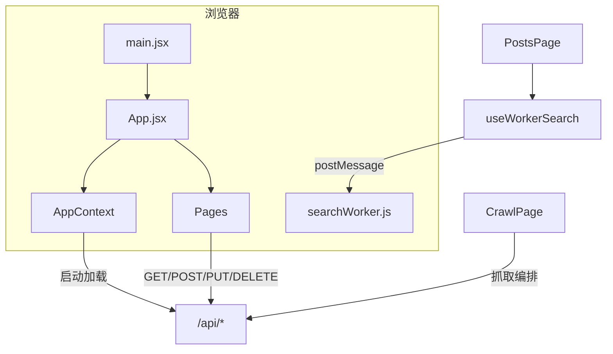
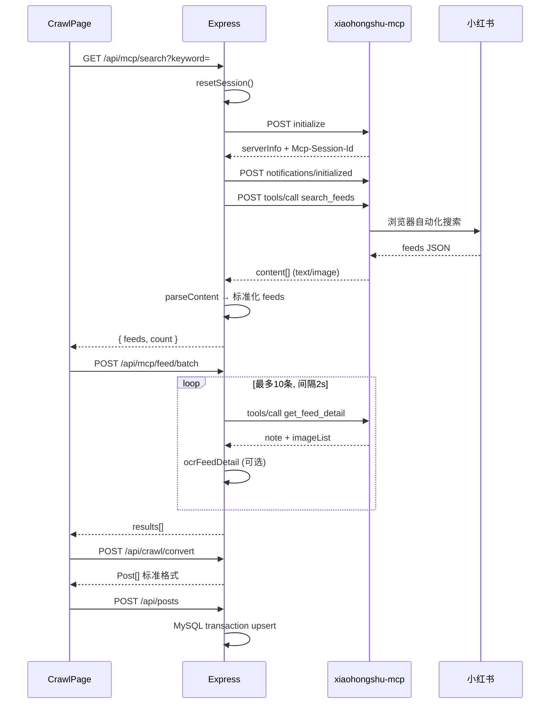
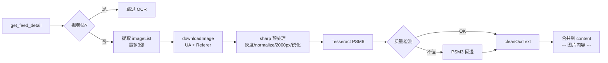
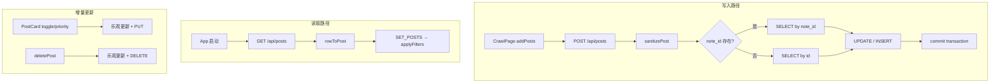
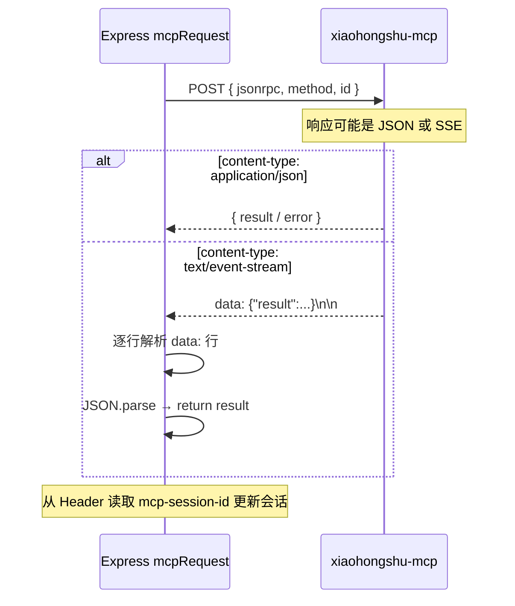
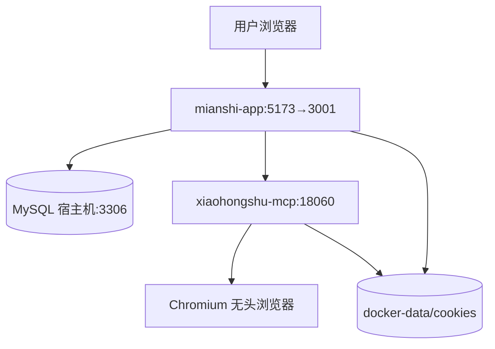
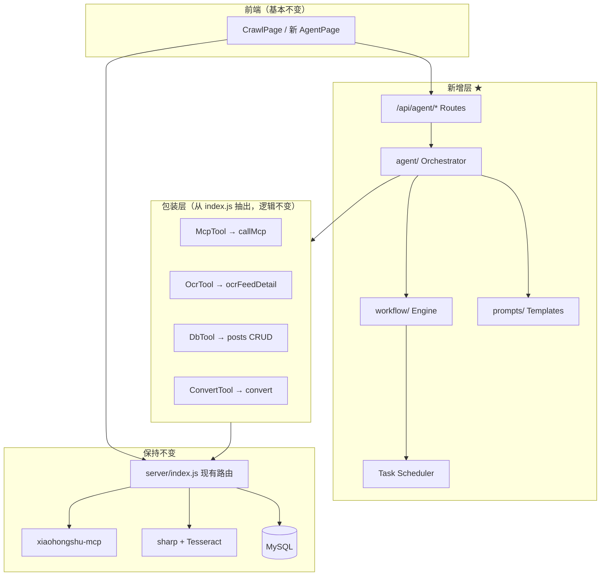

面经助手 — Tech Lead 架构分析报告

基于对 `xiaohongshu-mianshi` 全量代码阅读（未修改任何文件）。  
项目路径：`D:\xhs-mianshi\xiaohongshu-mianshi`
1. 当前项目架构

1.1 总体定位

面经助手是一个全栈 Web 应用：通过 xiaohongshu-mcp（外部 MCP 服务 + 无头浏览器）抓取小红书面经，经 OCR 提取图片文字，存入 MySQL，由 React 前端展示、筛选、统计。

当前后端为 **单体架构**：`server/index.js`（~828 行）集中了 HTTP 路由、MCP 客户端、OCR 管线、数据校验与 DB 访问。前端为 **React 19 + Vite SPA**，生产环境由 Express 托管 `dist/`。

---

### 1.2 前端结构

```text
src/
├── main.jsx                 # 入口：StrictMode + BrowserRouter + Providers
├── App.jsx                  # 布局：Sidebar + Routes
├── constants.js             # 分类、颜色、关键词常量
├── context/
│   └── AppContext.jsx       # 全局状态：posts / 筛选 / 统计 / CRUD API
├── pages/
│   ├── HomePage.jsx         # 首页：统计、最新/热门面经
│   ├── PostsPage.jsx        # 列表：分类 + Worker 搜索 + 排序
│   ├── CategoriesPage.jsx   # 分类浏览（URL ?cat=）
│   ├── DashboardPage.jsx    # Recharts 看板
│   └── CrawlPage.jsx        # 抓取控制台（MCP / 模拟）
├── components/
│   ├── Sidebar.jsx          # 导航
│   ├── PostCard.jsx         # 卡片 + 状态/优先级/删除
│   ├── PostDetail.jsx       # 详情弹窗 + Markdown 渲染 + 笔记
│   └── Toast.jsx            # 全局错误提示
├── hooks/
│   └── useWorkerSearch.js   # Web Worker 搜索封装
├── workers/
│   └── searchWorker.js      # 后台索引与搜索
└── utils/
    └── searchIndex.js       # 分词 + 倒排索引
```

**前端数据流：**



**开发 / 生产差异：**

| 环境 | 前端 | API |
|------|------|-----|
| 开发 | Vite `:5173`，proxy `/api → :3001` | Express `:3001` |
| 生产 | Express 静态托管 `dist/` | 同端口 `:3001`（Docker 映射宿主机 `:5173`） |

---

### 1.3 后端结构

```text
server/
└── index.js    # 全部后端逻辑（无分层目录）

职责块（逻辑分区，非物理模块）：
├── HTTP Middleware     cors / json / 日志 / static / SPA fallback
├── MySQL Pool          initDB / rowToPost
├── MCP Client          mcpRequest / callMcp / parseContent / session
├── OCR Pipeline        download → sharp → tesseract → clean
├── Validation          sanitizePost / sanitizeString
└── REST Routes         /api/posts / /api/mcp/* / /api/crawl/*
```

**后端 API 一览：**

| 路由 | 方法 | 职责 |
|------|------|------|
| `/api/posts` | GET | 全量读库 |
| `/api/posts` | POST | 批量 upsert（事务） |
| `/api/posts/:id` | PUT/DELETE | 状态/优先级/删除 |
| `/api/mcp/status` | GET | MCP 连通 + 登录态 |
| `/api/mcp/search` | GET | 关键词搜索 feeds |
| `/api/mcp/feed/batch` | POST | 批量详情 + OCR |
| `/api/crawl/convert` | POST | 原始 feed → Post 模型 |
| `/api/health` | GET | 健康检查 |

---

### 1.4 MCP 调用流程

MCP 服务为 **独立进程/容器**（`xiaohongshu-mcp`，端口 `18060`），本应用通过 **JSON-RPC 2.0 over HTTP** 调用其 `tools/*`。



**MCP 工具映射：**

| MCP Tool | 用途 |
|----------|------|
| `check_login_status` | 登录检测 |
| `get_login_qrcode` | 扫码登录 |
| `search_feeds` | 关键词搜索 |
| `get_feed_detail` | 帖子详情（需 feed_id + xsec_token） |
| `list_feeds` | 列表（已暴露，前端未用） |

**会话策略：**

- 内存维护 `mcpSessionId` / `mcpInitialized`
- `callMcp` 失败 → `resetSession()` → 重试 1 次
- 搜索 / 批量前 **强制 resetSession**，降低超时风险

---

### 1.5 OCR 流程

OCR 在 **`POST /api/mcp/feed/batch`** 内触发，仅对非视频帖、且 `ocr=true`（默认）时执行。



**依赖：**

- **sharp**：Node 图片预处理
- **Tesseract**：系统二进制（`TESSERACT_PATH`，Docker 内已装 `chi_sim+eng`）

---

### 1.6 数据库存储流程

**Schema：** 单表 `posts`（`init-db.sql`）



**关键字段：** `note_id`（UNIQUE，去重）、`content`（含 OCR）、`tags`（JSON）、`status` / `priority`

---

### 1.7 SSE 通信流程

> 注意：本项目 **前端不直接使用 SSE**。SSE 出现在 **Express ↔ MCP 服务** 的 HTTP 响应中。

MCP HTTP Transport 的响应 `Content-Type` 可能为 `text/event-stream`。服务端在 `mcpRequest` 中解析：



**与经典 SSE 长连接的区别：**

| 维度 | 本项目 MCP SSE | 典型 SSE 推送 |
|------|----------------|---------------|
| 方向 | 请求-响应式 POST | 服务端单向长连接 |
| 客户端 | 仅 Express 解析 | 浏览器 EventSource |
| 用途 | MCP 协议兼容 | 实时日志/进度 |

---

### 1.8 部署拓扑



---

## 2. 当前模块职责

> 项目 **无** 独立的 routes/services/controllers 目录；下表按 **逻辑模块** 映射到实际代码位置。

| 逻辑模块 | 物理位置 | 职责 |
|----------|----------|------|
| **HTTP Routes** | `server/index.js` L436–819 | 暴露 REST API；参数校验；HTTP 状态码 |
| **Static / SPA** | `server/index.js` L83, L821–822 | 托管 `dist/`；非 API 回退 `index.html` |
| **Database** | `server/index.js` L18–49, L438–545 | 连接池、CRUD、事务批量 upsert、`rowToPost` |
| **Validation** | `server/index.js` L401–434 | 输入清洗、枚举校验、长度限制 |
| **MCP Client** | `server/index.js` L85–208 | 会话管理、JSON-RPC、SSE 解析、`callMcp` 重试 |
| **MCP Routes** | `server/index.js` L547–770 | 搜索/详情/登录/批量抓取编排 |
| **OCR Service** | `server/index.js` L210–399 | 下载、sharp 预处理、Tesseract、清洗、feed 级合并 |
| **Convert Service** | `server/index.js` L772–819 | feed → Post 模型；关键词分类 |
| **Frontend Router** | `src/App.jsx` + `Sidebar.jsx` | 5 页路由 |
| **State Management** | `src/context/AppContext.jsx` | posts、筛选、统计、API 同步、乐观回滚 |
| **Crawl Orchestrator（前端）** | `src/pages/CrawlPage.jsx` | 多关键词串行搜索 → 去重 → batch → convert → save |
| **Search Worker** | `hooks/` + `workers/` + `utils/searchIndex.js` | 倒排索引、Worker 内搜索、主线程高亮 |
| **UI Components** | `src/components/*` | 卡片、详情、Toast |
| **Charts** | `src/pages/DashboardPage.jsx` | Recharts 统计可视化 |
| **Constants** | `src/constants.js` | 分类配置（与 server convert 部分重复） |
| **External MCP** | Docker `xiaohongshu-mcp` | 浏览器自动化、小红书交互 |
| **External DB** | MySQL `mianshi_app.posts` | 持久化 |

**当前架构特征：**

- ✅ 功能闭环完整  
- ⚠️ 后端高耦合、难单测  
- ⚠️ 抓取编排在前端（CrawlPage），长任务无服务端 Job  
- ⚠️ `COOKIES_PATH` 已定义但未在 server 中使用  

---

## 3. Agent 接入位置（不修改原有逻辑）

### 3.1 设计原则

| 原则 | 说明 |
|------|------|
| **Strangler Fig** | 新能力走 Agent 层；旧 API 保持可用 |
| **Tool 包装** | Agent 不直接操作 MCP/OCR，而是调用现有函数封装 |
| **Workflow 编排** | 把 CrawlPage 里的串行流程下沉到服务端 Workflow |
| **Prompt 外置** | 行为由 `prompts/` 驱动，便于迭代 |

### 3.2 Agent 应放置的层级



**推荐落点：Express 与 MCP/OCR/DB 之间的「编排 intelligence 层」**

- Agent **不负责**浏览器自动化（仍由 xiaohongshu-mcp 负责）  
- Agent **不负责**像素级 OCR（仍由 sharp + Tesseract 负责）  
- Agent **负责**：规划抓取策略、质量评估、结构化抽取、失败决策、任务调度  

### 3.3 模块变更矩阵

| 模块 | 策略 | 说明 |
|------|------|------|
| `xiaohongshu-mcp` | **保持不变** | 外部服务，不改 |
| OCR 管线 | **保持不变** | 抽出为 `server/services/ocr.js`，函数体原样迁移 |
| MCP Client | **包装** | 抽出为 `server/services/mcp.js`，`callMcp` 接口不变 |
| DB 访问 | **包装** | 抽出为 `server/services/posts.js` |
| 现有 REST API | **保持不变** | `/api/posts`、`/api/mcp/*` 继续服务旧前端 |
| `CrawlPage` | **保持不变** | 可并行新增「Agent 抓取」入口，旧按钮仍可用 |
| `AppContext` / 列表页 | **保持不变** | 仍消费 `/api/posts` |
| `agent/` | **新增** | Planner、Executor、Tool Registry、LLM Adapter |
| `workflow/` | **新增** | 抓取/ enrichment 状态机、Scheduler、Job Store |
| `prompts/` | **新增** | 规划、分类、摘要、Q&A 等 Prompt 模板 |
| `/api/agent/*` | **新增** | 任务创建、进度 SSE（可选）、结果查询 |
| 前端 Agent UI | **新增（可选）** | `AgentPage` 或 CrawlPage Tab，消费新 API |

### 3.4 Agent 典型能力场景

| 场景 | Agent 角色 | 复用的旧模块 |
|------|------------|--------------|
| **智能抓取** | 根据用户目标岗位生成关键词 → 调度 workflow | `callMcp(search/batch)` |
| **内容理解** | OCR 后 LLM 提取「公司/轮次/题目/答案要点」 | `ocrFeedDetail` + 新字段或 JSON 列 |
| **质量过滤** | 判断是否为有效面经，低质量跳过入库 | `sanitizePost` + convert |
| **失败恢复** | 决定 retry / skip / 换关键词 | 现有 resetSession + workflow retry |
| **面经问答** | RAG：检索 posts → LLM 回答 | GET posts + 新 vector/全文索引（后期） |

---

## 4. 新目录结构（保留全部现有目录）

```text
xiaohongshu-mianshi/
├── agent/                          # ★ 新增：Agent 核心
│   ├── index.js                    # Agent 入口 / 注册
│   ├── orchestrator.js             # 接收目标 → 选 workflow → 执行
│   ├── planner.js                  # LLM 规划：关键词、批次、停止条件
│   ├── executor.js                 # 逐步执行 tool calls
│   ├── llm/
│   │   ├── client.js               # OpenAI/Claude/本地模型适配
│   │   └── config.js               # API Key、模型名（读 .env）
│   ├── tools/                      # 对现有能力的 Tool 包装（不改内部逻辑）
│   │   ├── mcp.tool.js             # → callMcp / search / detail
│   │   ├── ocr.tool.js             # → ocrFeedDetail
│   │   ├── posts.tool.js           # → DB upsert/query
│   │   ├── convert.tool.js         # → crawl convert 逻辑
│   │   └── registry.js             # Tool 注册表
│   ├── memory/
│   │   ├── session.store.js        # 单次任务上下文
│   │   └── job.store.js            # 任务状态持久化（可先内存/JSON）
│   └── types.js                    # Job / Step / ToolResult 结构约定
│
├── workflow/                       # ★ 新增：工作流引擎
│   ├── engine.js                   # 状态机：pending → running → done/failed
│   ├── scheduler.js                # 定时/队列调度（cron、延迟、并发控制）
│   ├── retry.js                    # 重试策略（指数退避、maxAttempts）
│   ├── definitions/
│   │   ├── crawl.workflow.js       # 搜索→详情→OCR→convert→save
│   │   ├── enrich.workflow.js      # LLM 结构化/摘要
│   │   └── qa.workflow.js          # 检索+问答（后期）
│   └── events.js                   # 步骤事件：onStepStart/onStepFail
│
├── prompts/                        # ★ 新增：Prompt 模板（Markdown/JSON）
│   ├── planner.system.md           # 抓取规划系统提示
│   ├── planner.user.md             # 用户目标 → 关键词模板
│   ├── classify.md                 # 岗位/公司分类
│   ├── summarize.md                # 面经摘要
│   ├── quality-filter.md           # 低质量过滤
│   ├── enrich-structure.md         # 抽取 QA 结构
│   └── qa.system.md                # 面经问答
│
├── server/                         # 保留，逐步 refactor
│   ├── index.js                    # 保留：现有路由 + 挂载 /api/agent
│   ├── routes/                     # 新增（从 index.js 渐进抽出）
│   │   ├── posts.routes.js
│   │   ├── mcp.routes.js
│   │   ├── crawl.routes.js
│   │   └── agent.routes.js         # ★ POST /api/agent/jobs 等
│   └── services/                   # 新增（从 index.js 原样迁出）
│       ├── mcp.service.js
│       ├── ocr.service.js
│       ├── posts.service.js
│       └── convert.service.js
│
├── src/                            # 保留全部现有前端
│   ├── pages/
│   │   └── AgentPage.jsx           # 可选新增：Agent 任务面板
│   └── ...                         # 其余不变
│
├── docs/                           # 保留
├── docker-data/                    # 保留
├── init-db.sql                     # 保留（后期可加 agent_jobs 表）
├── docker-compose.yml              # 保留（后期加 LLM env）
├── Dockerfile                      # 保留
├── package.json                    # 保留
└── ...                             # 所有现有文件/目录均保留
```

**Refactor 顺序建议：** 先 **copy-out**（抽出 service，index.js re-export）→ 再 **agent 调 service** → 最后 **thin index.js**。任何阶段旧 API 行为不变。

---

## 5. 完整开发计划（Milestone）

> 每个 Milestone ≤ **半天（~4h）**；不含具体代码，仅方案与验收标准。

---

### Milestone 1 — Task Scheduler（任务调度基础）

**目标：** 建立异步任务基础设施，不改变现有同步抓取路径。

| 任务 | 内容 |
|------|------|
| 1.1 | 设计 `Job` 模型：`id, type, status, steps[], result, error, createdAt` |
| 1.2 | 实现 `workflow/scheduler.js`：内存队列 + 单 worker 消费（后期可换 Redis） |
| 1.3 | 实现 `agent/memory/job.store.js`：CRUD + 状态流转 |
| 1.4 | 新增 `POST /api/agent/jobs`（创建空 job）、`GET /api/agent/jobs/:id`（查状态） |
| 1.5 | `init-db.sql` 可选追加 `agent_jobs` 表（或 Phase 1 仅内存） |

**验收：** 能创建 job、查询 pending→running→completed；现有 `/api/mcp/*` 无行为变化。

---

### Milestone 2 — Planner（规划 Agent）

**目标：** LLM 根据用户目标生成抓取计划，仍不自动执行。

| 任务 | 内容 |
|------|------|
| 2.1 | `prompts/planner.system.md` + `planner.user.md`：输入岗位/公司 → 输出关键词列表、优先级、maxFeeds |
| 2.2 | `agent/llm/client.js`：统一 LLM 调用（env: `LLM_API_KEY`, `LLM_MODEL`） |
| 2.3 | `agent/planner.js`：加载 prompt → 调用 LLM → 解析 JSON plan |
| 2.4 | `POST /api/agent/plan`：返回 plan preview，不写库 |

**验收：** 输入「前端实习 字节」→ 返回结构化 keywords[]；CrawlPage 仍可手动抓取。

---

### Milestone 3 — Retry（重试与容错）

**目标：** 将现有 MCP/OCR 重试逻辑纳入 workflow 统一策略。

| 任务 | 内容 |
|------|------|
| 3.1 | `workflow/retry.js`：`maxAttempts=2`、区分 timeout / 4xx / OCR 空结果 |
| 3.2 | 从 `server/index.js` **复制** MCP session reset 逻辑到 `workflow/retry.js` 回调钩子（不删旧逻辑） |
| 3.3 | Step 级日志：`{ step, attempt, error, action: retry|skip|abort }` |
| 3.4 | Job 失败时保留 partial results |

**验收：** 模拟 MCP 超时 → workflow 自动 retry 并成功或 marked failed；旧 batch API 仍独立可用。

---

### Milestone 4 — Workflow（抓取工作流编排）

**目标：** 服务端完整复刻 CrawlPage 编排，Agent 驱动执行。

| 任务 | 内容 |
|------|------|
| 4.1 | 从 `index.js` 抽出 `server/services/{mcp,ocr,posts,convert}.service.js`（函数体不变） |
| 4.2 | `agent/tools/*.tool.js` 薄包装上述 service |
| 4.3 | `workflow/definitions/crawl.workflow.js` 步骤：`plan → search* → dedupe → batchDetail → convert → save` |
| 4.4 | `agent/orchestrator.js` + `executor.js` 串联 planner + workflow |
| 4.5 | `POST /api/agent/jobs/crawl`：body `{ goal: "前端实习" }` → 异步执行 |
| 4.6 | 可选：`GET /api/agent/jobs/:id/events` SSE 推送步骤进度（**此处 SSE 给前端用**） |

**验收：** 前端只发一个 goal，后台完成与 CrawlPage 等价的入库；CrawlPage 手动流程仍可用。

---

### Milestone 5 — Enrich Workflow（LLM 后处理，可选增强）

**目标：** OCR 文本 → 结构化面经（面试亮点）。

| 任务 | 内容 |
|------|------|
| 5.1 | `prompts/enrich-structure.md`：抽取 company、round、questions[]、tags |
| 5.2 | `workflow/definitions/enrich.workflow.js`：对新增 post 异步 enrich |
| 5.3 | DB 扩展：`content_structured JSON` 或 `posts_meta` 表 |
| 5.4 | PostDetail 新增 Tab「结构化面经」（只读展示） |

**验收：** 抓取完成后自动 enrich；旧 content 字段不变。

---

### Milestone 6 — Deploy（部署与配置）

**目标：** Agent 层可 Docker 部署，配置清晰。

| 任务 | 内容 |
|------|------|
| 6.1 | `.env.example` 增加 `LLM_API_KEY`, `LLM_BASE_URL`, `LLM_MODEL`, `AGENT_MAX_CONCURRENCY` |
| 6.2 | `docker-compose.yml` 注入 LLM 环境变量 |
| 6.3 | `Dockerfile` 确保 `agent/`、`workflow/`、`prompts/` 复制进镜像 |
| 6.4 | `docs/architecture.md` 更新 Agent 层说明 |
| 6.5 | 健康检查：`/api/agent/health` 含 LLM 连通性 |

**验收：** `docker compose up` 后 Agent job 可创建并完成；无 LLM Key 时 graceful 降级（仅 manual crawl）。

---

### Milestone 7 — Frontend Agent UI（前端接入，可选）

**目标：** 前端实习向亮点：Agent 任务面板 + 进度 SSE。

| 任务 | 内容 |
|------|------|
| 7.1 | `src/pages/AgentPage.jsx`：输入 goal、展示 plan preview、启动 job |
| 7.2 | EventSource 订阅 job 进度，步骤日志 UI（复用 CrawlPage 日志样式） |
| 7.3 | Sidebar 增加「智能抓取」入口 |
| 7.4 | 与现有 CrawlPage 并存，Tab 切换「手动 / 智能」 |

**验收：** 用户全程可在新页面完成 Agent 抓取；原 CrawlPage 无回归。

---

## 附录：风险与依赖

| 风险 | 缓解 |
|------|------|
| LLM 成本 / 延迟 | Planner 可选；Enrich 异步；缓存 plan |
| 后端 refactor 破坏旧 API | Strangler：先 copy-out，index.js 委托调用 |
| Job 持久化 | M1 内存 → M6 落库 |
| 小红书限流 | Workflow 保留 2s 间隔；Agent 不提高并发 |
| 前端实习 scope | M1–M4 偏后端；M7 为前端 showcase |

---

**总结：** 当前项目是 **功能完整的单体全栈应用**；Agent 最佳接入点是 **Express 之上的编排层**，通过 **Tool 包装** 复用 MCP/OCR/DB，通过 **Workflow + Scheduler** 取代前端 CrawlPage 的长流程编排，原有 API 与页面可零破坏保留。建议实施顺序：**M1 → M2 → M3 → M4 → M6**，M5/M7 按面试展示需求选做。
